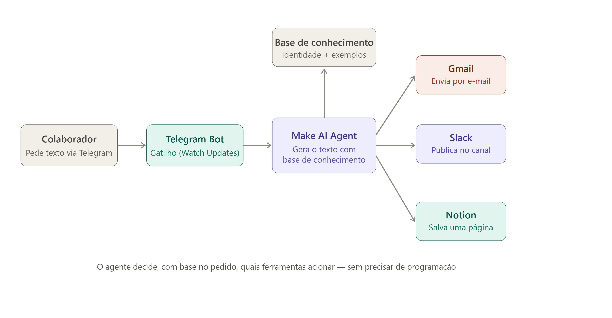
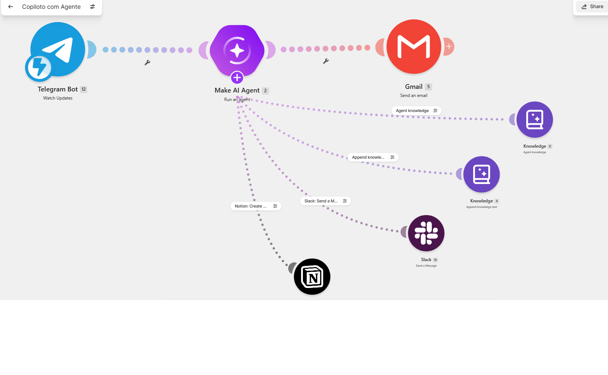
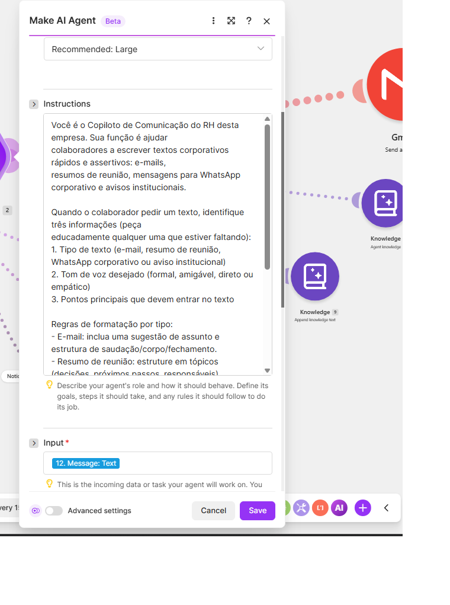
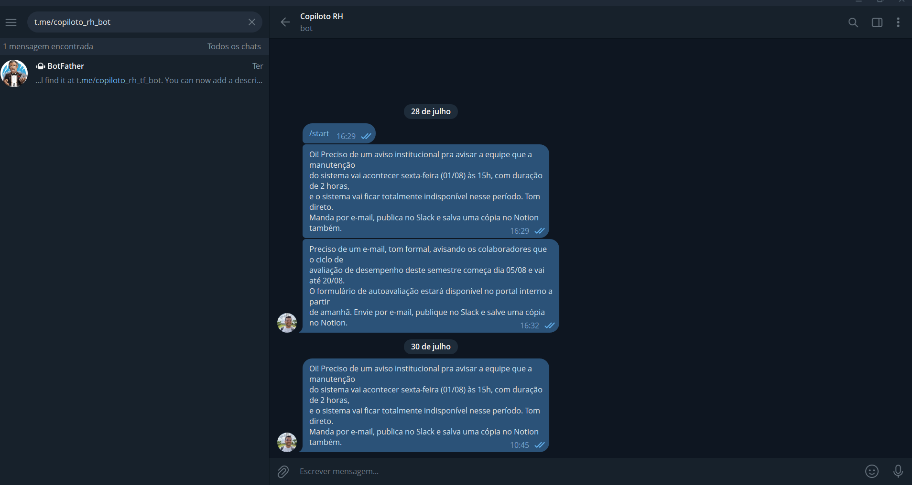
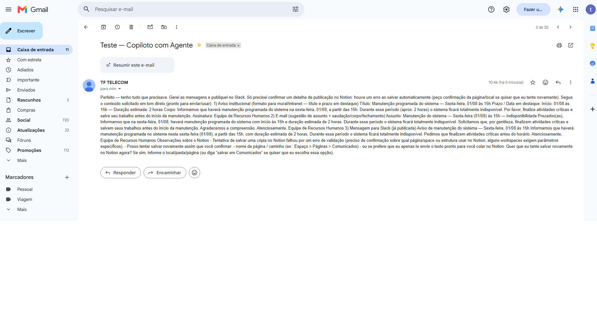
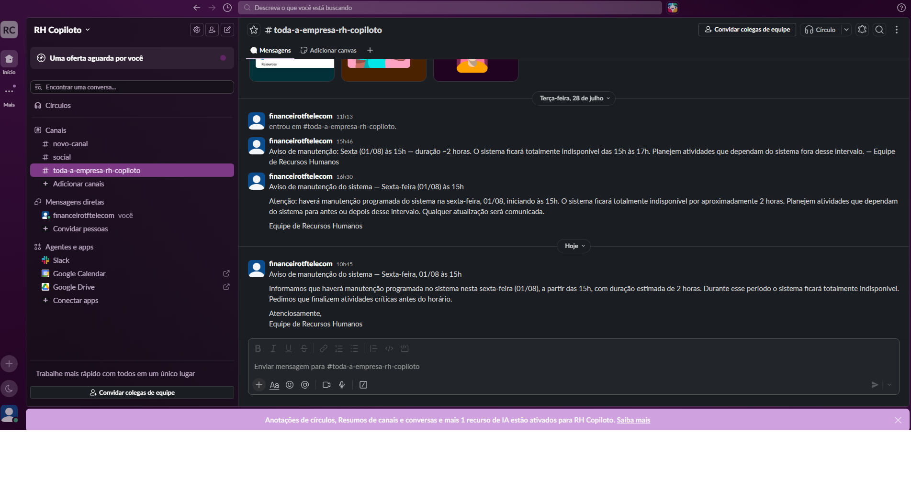
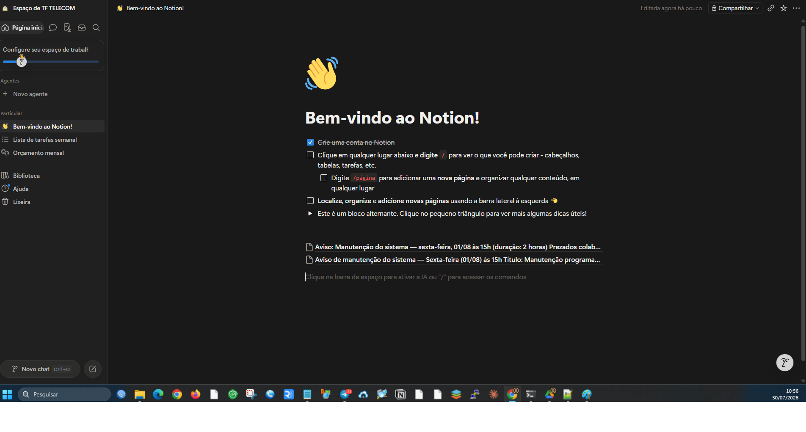

<h1 align="center">🤖 Copiloto de RH com IA Generativa</h1>

<p align="center">
  Agente de IA que recebe pedidos pelo <b>Telegram</b> e entrega textos corporativos prontos por <b>e-mail</b>, <b>Slack</b> e <b>Notion</b>, sem uma linha de código.
</p>

<p align="center">
  
  
  
  
  
</p>

<p align="center">
  
</p>

---

## 💡 O problema

O RH gasta muito tempo escrevendo textos repetitivos: e-mails, avisos, resumos de reunião e mensagens para grupos. Cada pessoa escreve de um jeito, o tom muda de um comunicado para outro e sobra pouco tempo para o trabalho estratégico.

## ✅ A solução

Um **copiloto conversacional**. O colaborador manda uma mensagem no Telegram dizendo o que precisa, e o agente:

1. **Entende o pedido** em linguagem natural: tipo de texto, tom de voz e pontos principais.
2. **Pergunta o que faltar**, em vez de inventar informação.
3. **Consulta a base de conhecimento** com a identidade da empresa e exemplos de bons textos.
4. **Decide sozinho** quais ferramentas acionar, sem nenhum fluxo `if/else` programado:
   - 📧 envia por **Gmail**
   - 💬 publica no canal do **Slack**
   - 📝 salva uma cópia no **Notion**
5. **Reporta o status** de cada ferramenta no e-mail de resposta, inclusive as falhas.

## 🧠 Arquitetura

| Camada | O que faz |
|---|---|
| **Telegram Bot** (`Watch Updates`) | Gatilho do cenário; recebe a mensagem do colaborador |
| **Make AI Agent** (LLM "Large") | Interpreta o pedido, gera o texto e escolhe as ferramentas (*tool use*) |
| **Knowledge** | Base de conhecimento com o tom institucional; o agente consulta e pode acrescentar exemplos |
| **Tools** | `Slack: Send a Message`, `Notion: Create a Page`, busca e atualização da base |
| **Gmail** | Etapa fixa no fim do fluxo: entrega o texto final ao solicitante |

O projeto começou com uma chamada simples ao modelo (`Ask Anything`) e evoluiu para um **agente com ferramentas** (*tool-augmented LLM*), que executa ações reais em vez de só gerar texto.

O prompt de sistema está em [`prompt/system-prompt.md`](prompt/system-prompt.md).

## 📸 Funcionando

| Cenário no Make | Configuração do agente |
|---|---|
|  |  |

| Pedido no Telegram | Texto entregue por e-mail |
|---|---|
|  |  |

| Publicação no Slack | Páginas no Notion |
|---|---|
|  |  |

## 🔧 Desafios que resolvi

- **Gatilho "órfão":** o módulo do Telegram existia no cenário, mas não estava ligado ao agente. Reestruturei o fluxo para ele ser o primeiro módulo.
- **Mapeamento da entrada:** foi preciso escolher o campo certo (`message.text`) entre vários parecidos na estrutura de dados do Telegram.
- **Erro de validação no Notion:** o agente montava blocos mais complexos do que a API aceitava. Ajustei a descrição da ferramenta para usar um único bloco de parágrafo, e o erro sumiu.
- **Conexões OAuth:** Slack e Notion exigiram conexões próprias, incluindo um workspace de teste no Slack.

## 🔒 Ética e segurança

- **LGPD:** avisar que as mensagens passam por provedores externos e orientar a não enviar dados sensíveis.
- **Supervisão humana:** em produção, comunicados sensíveis devem passar por aprovação antes de publicar.
- **Credenciais:** usar contas de serviço, controle de acesso e rotação de tokens, principalmente o do bot do Telegram.

A análise completa está na [parte teórica](docs/parte-teorica.md).

## 📂 Estrutura

```
copiloto-rh-ia/
├── README.md
├── assets/    fluxograma e prints do funcionamento
├── docs/      parte teórica (.md e .docx original)
└── prompt/    prompt de sistema do agente
```

---

<p align="center">
  Trabalho da disciplina <b>Fundamentos de IA com foco em IA Generativa</b> · Graduação Tecnológica em Inteligência Artificial e Automação Digital · <b>UniFECAF</b><br>
  Feito por <a href="https://www.linkedin.com/in/thiago-felipe-17a35839">Thiago Felipe Oliveira</a>
</p>
